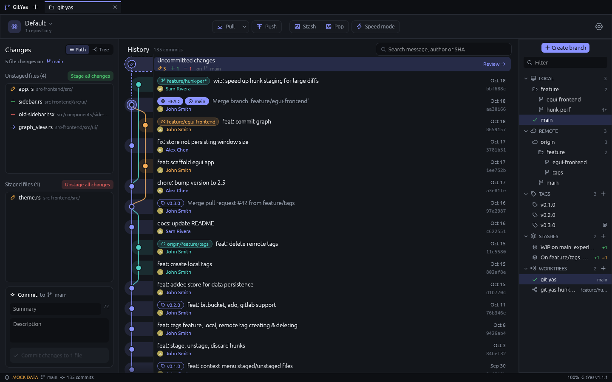
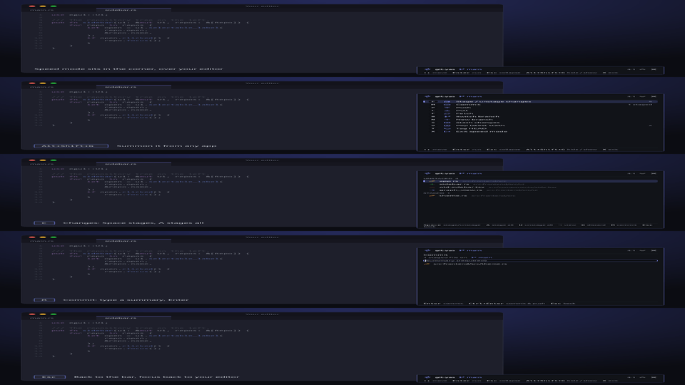
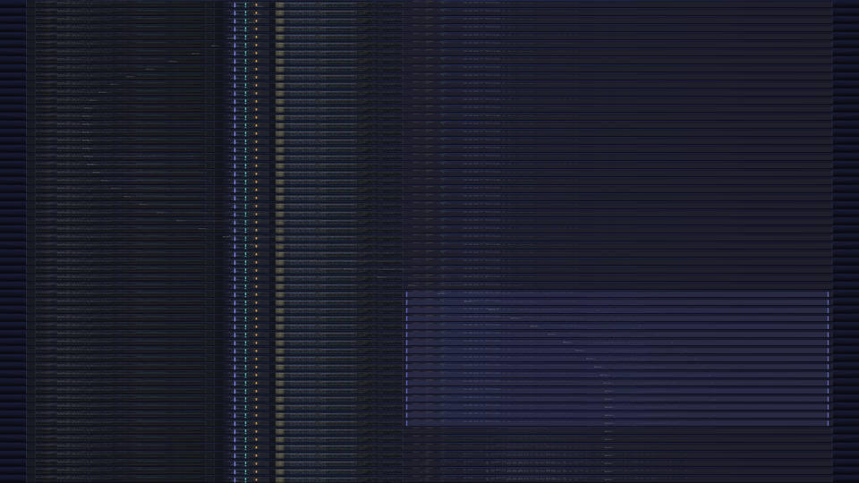
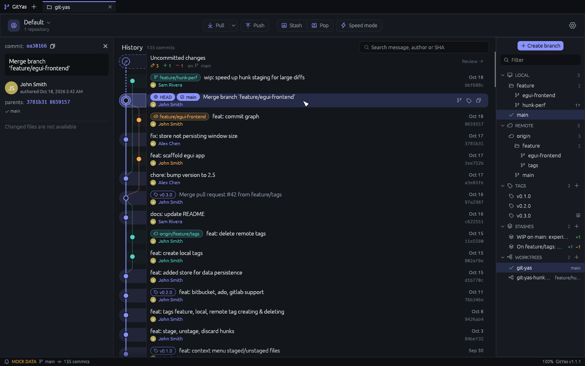
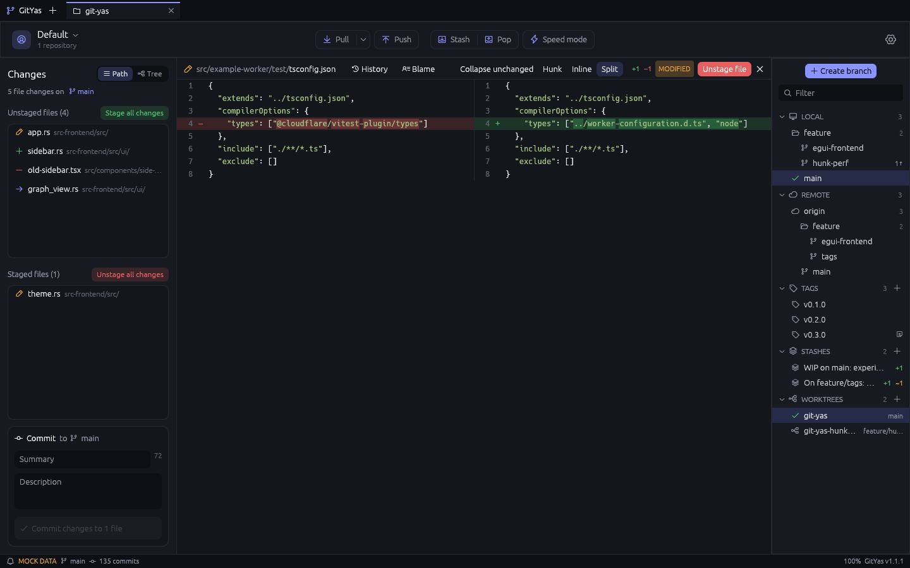
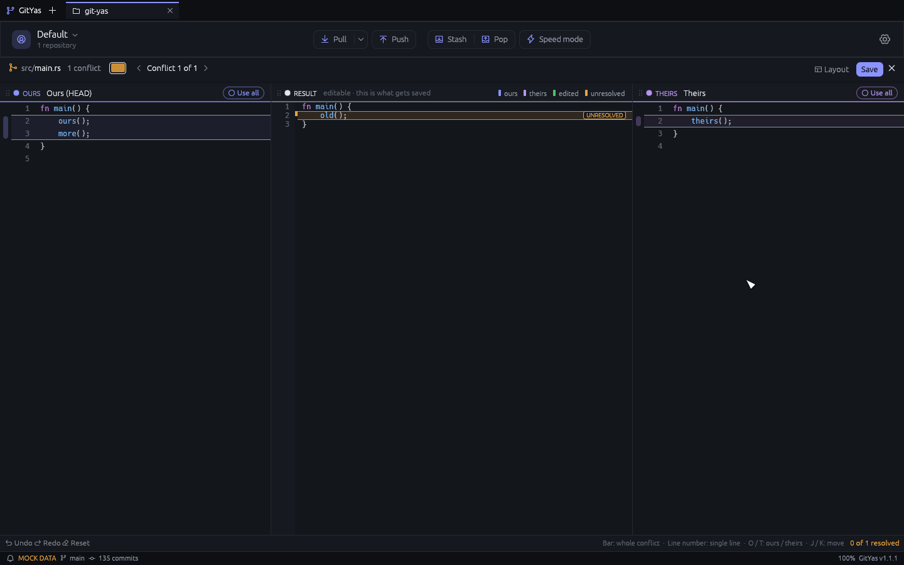
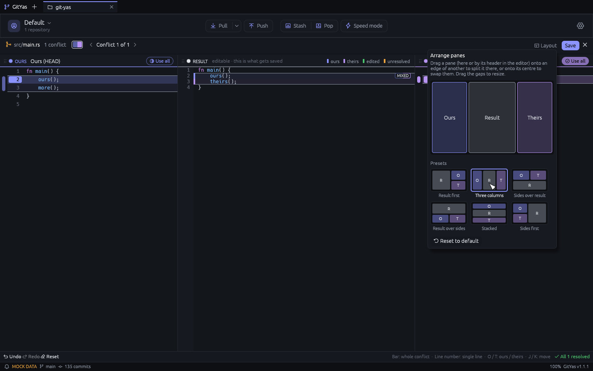
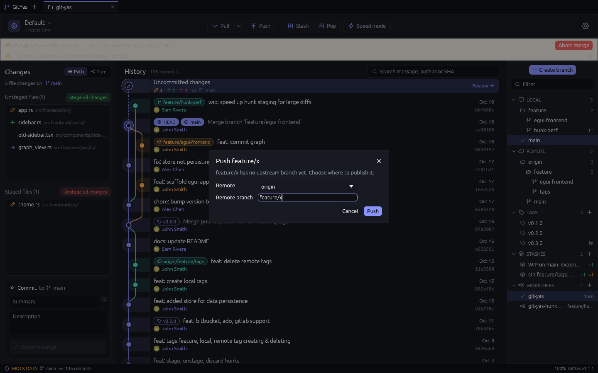
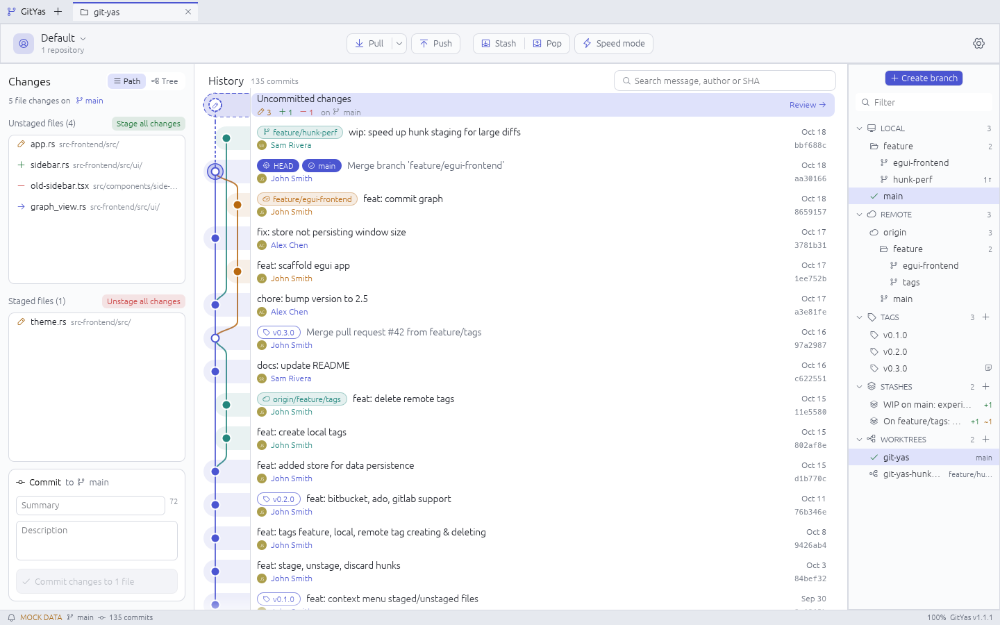

<p align="center">
  
</p>

<h1 align="center">GitYas</h1>

<p align="center">
  A fast, native Git GUI for Windows, macOS and Linux.<br>
  Free, open source and offline first. Built in 100% Rust.
</p>

<p align="center">
  <a href="https://getgityas.com"><b>Website</b></a> ·
  <a href="#download"><b>Download</b></a> ·
  <a href="#highlights"><b>Highlights</b></a> ·
  <a href="#everything-it-does"><b>Everything it does</b></a> ·
  <a href="docs/development.md"><b>Build from source</b></a>
</p>

<p align="center">
  <a href="https://github.com/yasir-fayrooz/GitYas-GUI/releases/latest"></a>
  <a href="https://github.com/yasir-fayrooz/GitYas-GUI/actions/workflows/ci.yml"></a>
  <a href="LICENSE"></a>
</p>

<p align="center">
  
</p>

<p align="center">
  No account, no sign-in, no tracking.<br>
  GitYas only goes online to talk to your remotes and check for updates.
</p>

## Why GitYas

- **Native, all the way down.** One Rust binary drawn on the GPU. No WebView, no Node, and no `git` executable needed:
  libgit2 is linked in.
- **Made for the keyboard.** Speed mode puts staging, committing and pushing one key away, from any app.
- **Fits around your editor.** Drag a changed file straight into VS Code, JetBrains, Zed or any editor to open it.
- **Merge conflicts on your terms.** Ours, theirs and the result are panes you arrange however you like.
- **Several branches at once.** Check a branch out in its own worktree and open each one in a tab, without stashing
  or switching.
- **Yours.** MIT licensed, with no paid plan, no trial and no feature limits.

## Highlights

<table>
  <tr>
    <td width="50%" valign="top">
      <br>
      <b>Speed mode.</b> GitYas shrinks to an always-on-top panel in the corner. Press <kbd>Alt</kbd>+<kbd>Shift</kbd>+<kbd>G</kbd>
      from any app, then <kbd>C</kbd> to stage, <kbd>M</kbd> to commit, <kbd>P</kbd> to push. The focus goes back to
      where you were typing.
    </td>
    <td width="50%" valign="top">
      <br>
      <b>Drag files into your editor.</b> Pull a changed file, or a whole selection, out of the Changes panel and drop
      it on your editor to open it, or on a chat or folder to share or copy it. Windows and macOS.
    </td>
  </tr>
  <tr>
    <td width="50%" valign="top">
      <br>
      <b>Every branch in one graph.</b> Each branch gets its own lane and colour, with local, remote and tag labels on
      their commits. Stashes and work in progress sit on the graph too.
    </td>
    <td width="50%" valign="top">
      <br>
      <b>Diffs three ways.</b> Read a change as a hunk, inline or side by side, with syntax highlighting and word-level
      changes. Stage or unstage a single hunk.
    </td>
  </tr>
  <tr>
    <td width="50%" valign="top">
      <br>
      <b>A merge editor you can rearrange.</b> Six layouts, from three columns to fully stacked. Drag a pane onto
      another to split or swap them, pick lines from either side, and edit the result directly.
    </td>
    <td width="50%" valign="top">
      <br>
      <b>Arrange panes from the Layout menu.</b> A live map of your panes sits above the presets. Drop a pane on an
      edge to split, on its centre to swap, and reset any time.
    </td>
  </tr>
  <tr>
    <td width="50%" valign="top">
      <br>
      <b>Push without the terminal.</b> Clone, fetch, pull and push over HTTPS or SSH. Personal access tokens for
      GitHub, GitLab, Bitbucket and Azure DevOps stay in your system keychain.
    </td>
    <td width="50%" valign="top">
      <br>
      <b>Light, dark or system.</b> Pick a theme, zoom the whole interface, and keep separate profiles for work and
      personal repositories.
    </td>
  </tr>
</table>

## Everything it does

One line each here. Release notes for every version are in the [changelog](CHANGELOG.md).

### History and the graph

- A commit graph with branches, tags and stashes, each branch in its own coloured lane
- Commit details: author, parents and message
- Search commits by message, author or SHA
- Checkout, branch, tag and reset straight from the graph
- Local and remote branches, tags, stashes and worktrees in a filterable sidebar

### Worktrees

- Every worktree of the repository in the sidebar, with the branch each one has checked out and the open one ticked
- Add a worktree on a new branch or an existing one, from the sidebar or a branch's **Check out in new worktree…**
- Open a worktree in its own tab with a double click, show it in your file manager or copy its path
- Remove a worktree (its branch is kept), with a second confirmation when it has uncommitted changes; prune ones
  whose folder is gone
- Locked and missing worktrees are marked, and worktrees added or removed with the `git` command line show up on
  their own

### Changes and committing

- Stage and unstage whole files or single hunks; stage or unstage everything at once
- A path view and a tree view of your changes
- Commit, stash with a message, pop, and discard changes
- Drag files out of the Changes panel into your editor, a chat or a folder (Windows and macOS)
- Your commit signature is filled in from your git config when none is set

### Diffs

- Hunk, inline and side-by-side views with syntax highlighting
- Word-level highlights inside changed lines
- Select diff text and copy it with or without the added or removed lines
- A file's history (renames followed) and blame in a full-screen view, with every version pinned on the left

### Speed mode

- A compact, always-on-top panel for the keyboard in the corner of your screen
- A global shortcut (<kbd>Alt</kbd>+<kbd>Shift</kbd>+<kbd>G</kbd>, <kbd>⌥</kbd><kbd>⇧</kbd><kbd>G</kbd> on a Mac) summons it from any app and hands the focus back afterwards
- One key per action: changes, commit, push, pull, fetch, switch branch (local and remote), new branch, stashes,
  tags
- Stash all changes, then apply, pop or delete a stash; create a tag (and push it) from a field, then push, check
  out or delete a tag
- Stage, unstage and discard from the list, view a file's diff, commit or commit and push
- The shortcut and every key can be changed in Settings → Git

### Merge conflicts

- A built-in three-way merge editor with six layouts, and panes you drag to split, swap and resize
- Pick single lines or whole conflicts from either side, or edit the result by hand, with undo, redo and reset
- Clear handling for binary, deleted, symlinked, submodule and very large files

### Remotes

- Clone, fetch, pull and push over HTTPS and SSH
- Personal access tokens for GitHub, GitLab, Bitbucket and Azure DevOps, kept in the system keychain, or your existing git
  credentials
- SSH through your ssh-agent or your default keys, with host keys checked against `known_hosts`
- Background fetch keeps your branches current; publish a new branch to any remote

### Comfortable every day

- Profiles: separate sets of repositories, settings, commit signature and credentials
- Tabs for several repositories at once
- Light, dark and system themes, and zoom
- Automatic updates from GitHub Releases, checked against a signature before they install, with a **What's new** dialog
  after each one

## Download

Get the latest version from the [Releases](https://github.com/yasir-fayrooz/GitYas-GUI/releases/latest) page or
[getgityas.com](https://getgityas.com):

- **Windows:** the `-setup.exe`.
- **macOS:** the `.zip` (Apple silicon or Intel). Unzip it and drag `GitYas.app` to Applications.
- **Linux:** the `.AppImage`, or the `.deb` for Debian and Ubuntu.

Installed copies update themselves from the same page. The Linux `.deb` shows a notice instead of updating itself.

- **macOS says GitYas "could not be verified"?** Open **System Settings → Privacy & Security** and click
  **Open Anyway**. You only need to do this once.

## Build from source

You need Rust 1.95 (pinned in `rust-toolchain.toml`). On Linux, install `libdbus-1-dev`, `libxkbcommon-dev`,
`libssl-dev` and `pkg-config` first.

```bash
cargo run -p gityas-frontend
```

Add `-- --mock` to run against built-in mock data. The code layout, tests, packaging and releases are covered in
[docs/development.md](docs/development.md) and [docs/releasing.md](docs/releasing.md).

## License

[MIT](LICENSE). Issues and pull requests are welcome.
